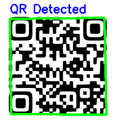
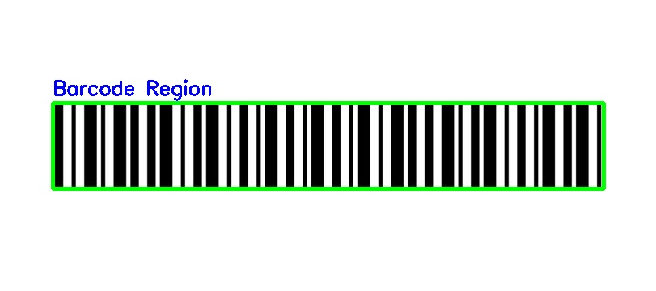

# Barcode & QR Code Scanner

Flask web application that **detects and decodes QR codes** and **locates and decodes barcodes** in an uploaded image using OpenCV. It returns the annotated image and the decoded content. A Jupyter notebook explains the image-processing pipeline step by step.

| QR code detection | Barcode localization |
|---|---|
|  |  |

## How it works

**QR codes**: `cv2.QRCodeDetector` detects and decodes the code. The app draws the code's outline on the image and shows its content. If the content is a URL, it is shown as a link.

**Barcodes**: a classical computer-vision pipeline, without deep learning:

1. Convert to grayscale.
2. Compute the **horizontal Sobel gradient** to highlight the vertical bars.
3. Apply a binary threshold.
4. Apply a **morphological closing** (25×7 rectangular kernel) to merge the bars into one region, then erode and dilate to remove noise.
5. Find the external **contours**.
6. Apply **geometric filters**: minimum area relative to the image size, and width/height ratio.
7. Draw a bounding box around the best candidate.
8. **Decode** with `cv2.barcode_BarcodeDetector`, first on the whole image, then on the detected region. If decoding fails, the location is still reported.

## Tech stack

Python, OpenCV, NumPy, Flask, HTML/CSS. The notebook also uses Jupyter, Matplotlib and ipywidgets.

## Project structure

```
app.py                        Flask app: upload, QR / barcode processing, results
templates/index.html          web interface (mode selection, upload, result)
static/style.css
code/barcode_qr_scanner.ipynb step-by-step notebook (pipeline, tests on sample images)
data/                         sample images
docs/images/                  example outputs for this README
```

## Getting started

```bash
pip install -r requirements.txt
python app.py
```

Open `http://127.0.0.1:5000`, choose **QR** or **Barcode** mode, and upload an image. Uploaded and annotated images are saved in `uploads/` and `results/`; both folders are excluded from Git.

## Limitations

- Barcode localization relies on fixed thresholds and kernel sizes. It works best on horizontal barcodes with good contrast, and rotated or curved barcodes may be missed.
- Decoding depends on OpenCV's barcode module (EAN/UPC family).
- Uploaded file names are used as they are, and the app runs in Flask debug mode. This is fine for local demos only.

## Possible improvements

- Correct the rotation using the minimum-area rectangle of the contour.
- Detect several codes in one image.
- Sanitize file names (`secure_filename`) and add a production configuration.
- Compare with a learned detector (for example YOLO) on a labeled dataset.
